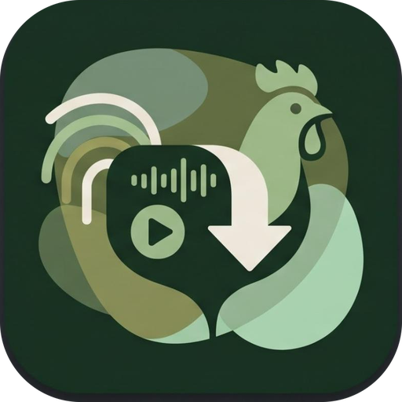

# Descargador para Android

App mínima (Kotlin) para descargar video o audio con **yt-dlp**: pegas o compartes un link (o buscas por nombre), eliges video/audio y formato, y listo.
Si se corta el internet, reintenta solo y retoma lo ya descargado. Los archivos quedan en `Descargas/Descargador`.

## Novedades de la 0.4
- **Buscador**: escribe un nombre (ej. "Rammstein") en la caja del link y toca *Buscar*. Fuentes: YouTube, listas de YouTube, YouTube Music y SoundCloud. Para cualquier otro sitio, pega el link.
- **Listas de YouTube**: marca "Descargar toda la lista"; se guardan en una carpeta con el nombre de la lista.
- **Temas**: botón *Tema* con 7 estilos, modo claro / oscuro / automático, color de botones a elección y foto de la galería como fondo.
- **Segundo plano**: las descargas siguen aunque cierres la app o apagues la pantalla, con el progreso (y botón Cancelar) en la barra de notificaciones.
- Ícono nuevo.

> Estado: versión 0.4, en pruebas.

## Cómo obtener el APK
Entra a **Releases** (columna derecha del repositorio) y descarga el `.apk` de la última versión.
Para publicar una versión nueva: `git tag v0.5 && git push origin v0.5` (GitHub Actions compila y la publica sola).

## Botones de la app
- **Actualizar**: busca la última Release de este repositorio y, si es más nueva, la descarga e instala. Al abrir la app también avisa sola si hay una versión nueva.
- **Feedback**: abre una *Issue* nueva en este repositorio con tu comentario, la versión de la app, el modelo de celular y el último error. También se puede compartir por WhatsApp o correo.

> El repositorio debe ser **público** para que los celulares puedan consultar las versiones sin iniciar sesión.

## Limitaciones
- Sin DRM (Netflix, Spotify, etc.), sin contenido privado o de pago.
- YouTube cambia seguido; si falla, hace falta actualizar la biblioteca de yt-dlp y recompilar.
- La búsqueda por nombre solo funciona en las fuentes de la lista; YouTube Music puede fallar si YouTube cambia algo.
- Una descarga a la vez.

## Créditos
- [yt-dlp](https://github.com/yt-dlp/yt-dlp), [youtubedl-android](https://github.com/yausername/youtubedl-android) (GPL-3.0) y FFmpeg.
- Código escrito con ayuda de [Claude](https://claude.ai) (Anthropic).

## Aviso legal
Úsalo solo con contenido que tengas derecho a descargar. Sin garantías.

## Licencia
GPL-3.0 (obligatoria porque la biblioteca youtubedl-android usa esa licencia). Ver `LICENSE`.
